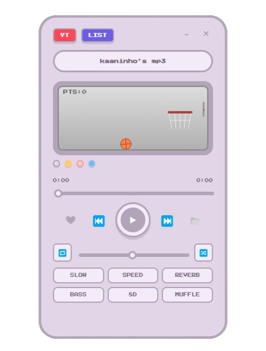

<div align="center">
  
  
  <h1>kaaninho's mp3</h1>
  <p><i>A simple, retro desktop music player.</i></p>
  
  
  
  
  [](https://github.com/halilkaandogan/kaaninhos-mp3/releases/latest)
</div>

<br/>

## About
I made **kaaninho's mp3** because I wanted a small, simple music player for my desktop. There are no ads or complex menus. It plays music directly from YouTube or your local files with a cool pixel-art style.

If you like retro designs and just want to listen to music while studying or gaming, you will like this!

<div align="center">
  
  <p><i>Main View</i></p>
</div>

<br/>

## Features
- **Search & Play:** Search for any song on YouTube and listen instantly.
- **Mini Player:** Keep a tiny, resizable square player always on top while gaming or browsing, with album art and ambient glow.
- **Local MP3 Files:** Play your own music files with automatic album cover support.
- **Queue System:** Add tracks to queue, reorder them with drag-and-drop, and manage Up Next easily.
- **Playlists:** Create your own playlists and organize your favorite songs.
- **Audio Effects:** Apply effects like Slow, Speed, Reverb, Bass Boost, 8D Audio, and Muffle with one click.
- **Smart Cache:** Fast song loading and zero lag with automatic stream caching.
- **Global Shortcuts:** Control music while in other apps or games (`Alt + P` to Play/Pause, `Alt + Right` / `Alt + Left` for Next/Prev, `Alt + +` / `Alt + -` to adjust volume smoothly).
- **Themes:** Change colors easily (Default, Black, Yellow, Pink, Blue).
- **Mini-Game:** Play a simple basketball game while listening.

## Download & Install
You don't need to install anything! Just download the `.exe` file from the **[Releases](https://github.com/halilkaandogan/kaaninhos-mp3/releases/latest)** page and open it.

## For Developers
If you want to run the project from source:

1. Clone this repository.
2. Make sure you have [Node.js](https://nodejs.org/) installed.
3. Download `yt-dlp.exe` and place it in the root folder.
4. Open your terminal in the folder and run:

```bash
npm install
npm start
```

> **Note for Linux / npm 10+ users:** If you encounter `Error: Electron failed to install correctly...`, run:
> ```bash
> npm rebuild electron
> npm start
> ```

To build the standalone `.exe` file:
```bash
npm run dist
```

## License
MIT
